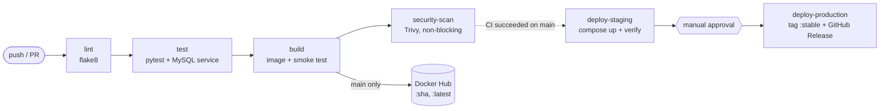

# Bookshelf — End-to-End DevOps Pipeline Demo

A small Flask + MySQL app with the full path from `git push` to a released Docker image.



| File | What it shows |
|---|---|
| `Dockerfile` | Multi-stage (base → test → production), slim image, layer caching, non-root, HEALTHCHECK, labels |
| `Dockerfile.broken` | The same app done badly, for a before/after size comparison |
| `docker-compose.yml` | db + app + Adminer + test-runner (profile), named volume, custom network, healthcheck-gated startup |
| `.github/workflows/ci-pipeline.yml` | lint → test → build → security-scan, concurrency, conditional push |
| `.github/workflows/deploy.yml` | Runs after CI on main: staging (auto) → production (approval) → release |

---

## One-time setup (do this before the first push)

1. **Docker Hub token** — hub.docker.com → Account settings → Personal access tokens → Generate (Read & Write).
2. **Create an empty GitHub repo** `bookshelf-devops-demo`.
3. **Repo → Settings → Secrets and variables → Actions**
   - *Variables* tab: `DOCKERHUB_USERNAME` = your Docker Hub username
   - *Secrets* tab: `DOCKERHUB_TOKEN` = the token
4. **Settings → Environments → New environment** `production` → tick *Required reviewers* → add yourself.
5. *(Optional)* **Settings → Rules → Rulesets** for `main`: require a PR and status checks `lint`, `test`, `build`. Set required approvals to **0**, otherwise you can't merge your own PR live.
6. Push:

```bash
cd bookshelf-devops-demo
git init -b main && git add . && git commit -m "feat: initial Bookshelf app and pipeline"
git remote add origin https://github.com/<you>/bookshelf-devops-demo.git
git push -u origin main
```

Let this first run finish completely (the first arm64 build takes a few minutes). Approve production once so Docker Hub and Releases already have content.

---

## Demo script (~25 min)

### 1. Local stack with Compose (5 min)

```bash
cp .env.example .env
docker compose up -d --build
docker compose ps                                   # db shows (healthy) before app starts
```

- App → http://localhost:5050
- Adminer → http://localhost:8080 (server `db`, user/password from `.env`, database `bookshelf`)

```bash
docker compose --profile test run --rm test-runner  # same Dockerfile, "test" stage, real DB
```

**Talking point:** `test-runner` never starts on a plain `up` because of its profile. The app waits for `service_healthy`, not just "container started".

### 2. Feature branch → Pull Request = CI only (7 min)

```bash
git checkout -b feature/new-heading
# templates/index.html: change <h1>Bookshelf</h1> to <h1>Bookshelf — DevOps Demo</h1>
git commit -am "feat(ui): update page heading" && git push -u origin feature/new-heading
```

Open a PR to `main`. Walk through the 4 jobs. In the **build** job, point out that the *Log in* and *Push* steps are **skipped**, so PRs are tested but never published. Show the Trivy report in the run summary and under Artifacts.

### 3. Merge → CD (8 min)

Merge the PR. Then show, in order:

1. The **CI Pipeline** run on `main`: this time the push steps run. On Docker Hub, the new `:<sha>` and `:latest` tags appear.
2. The **Deploy** workflow starts by itself once CI finishes.
3. **deploy-staging** pulls that exact image, starts it with MySQL, and checks that the running version equals the commit SHA. Show its summary.
4. **deploy-production** waits. Click *Review deployments* → *Approve*.
5. The `:stable` tag on Docker Hub and the new **GitHub Release**.

Then run what you just released on your laptop:

```bash
docker run -d --rm -p 5060:5000 --name released <dockerhub-user>/bookshelf:stable
curl localhost:5060/health      # "version" = the merged commit SHA
docker stop released
```

**Talking point:** production gets the same image that was tested. It is promoted, not rebuilt.

### 4. Red run: bad code never ships (3 min)

On a new branch, break a test, e.g. in `app.py` change `"title is required"` to `"title missing"`. Push and open a PR. **test** fails, so **build** and **security-scan** are skipped and nothing is published.

(For a faster version, add an unused `import os` to `app.py`. **lint** fails in about 10 seconds: fail fast.)

### 5. Optional extras (2–3 min each)

**Image optimization:**

```bash
docker build -f Dockerfile.broken -t bookshelf:broken .
docker build -t bookshelf:fixed .
docker images bookshelf                                     # roughly 1 GB vs ~200 MB
docker inspect bookshelf:broken --format '{{json .Config.Env}}'   # password visible!
```

**Volumes:** after `docker compose down`, data survives the next `up`. After `docker compose down -v`, the volume is deleted and `init.sql` re-seeds on the next `up`.

**Path filter:** a commit that only edits `README.md` triggers no pipeline at all.

---

## Run tests without Docker

```bash
python3 -m venv .venv && source .venv/bin/activate
pip install -r requirements.txt -r requirements-dev.txt
pytest -v      # unit tests run; DB integration tests are skipped unless MYSQL_HOST is set
```

## Cleanup

```bash
docker compose down -v
```
